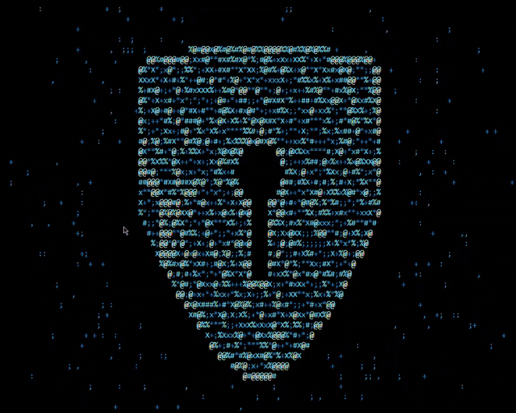

# Glyphform

### A particle animation engine for your terminal.

Glyphform is a Python-based terminal animation engine that uses particle physics, spring dynamics, and ANSI rendering to create animated visual forms directly inside your terminal.

Watch particles assemble into shapes, react to mouse interactions, and render custom text in motion.

---

## Features

- **Particle Physics:** Spring-based motion, velocity damping, and dynamic particle behaviour.
- **Interactive Scenes:** Animated heart, star, shield, and rocket.
- **Custom Text Rendering:** Turn your own text into animated particle formations.
- **Mouse Interaction:** Push, pull, and swirl particles using mouse input.
- **Dynamic Colours:** RGB colour ramps, particle flicker, and glow effects.
- **Terminal Rendering:** Incremental ANSI rendering for real-time visual output.
- **Modular Architecture:** Separate simulation, rendering, and shape-generation components.
- **Automated Tests:** Test coverage for core engine functionality.

## Preview



## Installation

### Requirements

- Python 3.9+
- NumPy
- Pillow
- An ANSI-compatible terminal

### 1. Clone the repository

```bash
git clone https://github.com/alpnoire/Glyphform.git
cd Glyphform
```

### 2. Create a virtual environment

**Windows:**

```powershell
py -m venv .venv
.venv\Scripts\Activate.ps1
```

**macOS / Linux:**

```bash
python3 -m venv .venv
source .venv/bin/activate
```

### 3. Install dependencies

```bash
python -m pip install -r requirements.txt
```

---

## Usage

### Launch the animation engine

```bash
python -m glyphform
```

You can also use:

```bash
python glyphform.py
```

### Generate custom particle text

```bash
python -m glyphform --text "GLYPHFORM"
```

Replace `GLYPHFORM` with your own text.

For the best experience, maximize your terminal window.

---

## Controls

| Input | Action |
|---|---|
| `N` or `Space` | Next scene |
| `P` | Previous scene |
| `Q` or `Ctrl+C` | Exit |
| Mouse movement | Push particles away |
| Hold left mouse button | Pull and swirl particles |
| Right-click or scroll wheel | Change scene |

Mouse interaction depends on terminal support.

---

## Architecture

Glyphform is organised into independent modules.

```text
Glyphform/
│
├── glyphform/
│   │
│   ├── engine/
│   │   └── world.py
│   │
│   ├── rendering/
│   │   └── screen.py
│   │
│   ├── shapes/
│   │   └── text_shape.py
│   │
│   ├── main.py
│   ├── settings.py
│   └── __main__.py
│
├── tests/
│
├── glyphform.py
├── requirements.txt
├── README.md
└── LICENSE
```

### Core components

| Component | Responsibility |
|---|---|
| Engine | Particle simulation and physics |
| Rendering | Terminal output and input handling |
| Shapes | Shape masks and custom text generation |
| Main | Application loop and frame timing |
| Settings | Runtime configuration |

---

## Configuration

Runtime parameters can be adjusted in:

`glyphform/settings.py`

| Parameter | Description |
|---|---|
| `FPS` | Target frame rate |
| `SCENE_SECONDS` | Duration of each scene |
| `DENSITY` | Particle density |
| `SEED` | Random number generator seed |

---

## Running Tests

Install pytest:

```bash
python -m pip install pytest
```

Run the test suite:

```bash
python -m pytest -q
```

---

## Technical Stack

- Python
- NumPy
- Pillow
- ANSI Escape Sequences
- Terminal-Based Rendering
- Particle Physics

---

## License

Glyphform is distributed under the MIT License.

---

**Built with Python. Rendered with particles. Powered by imagination.**
